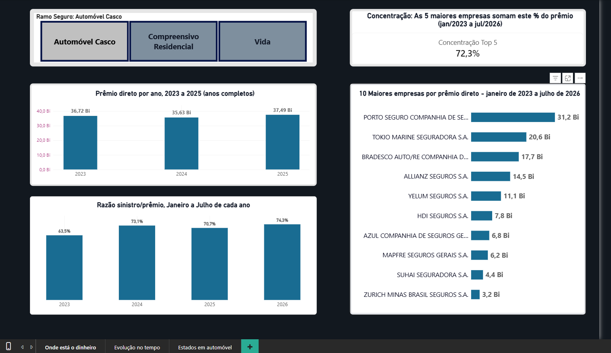
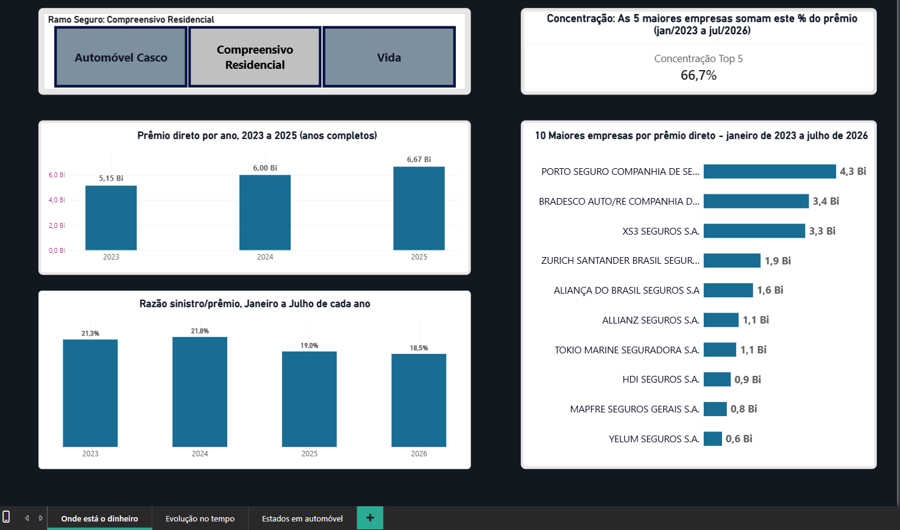
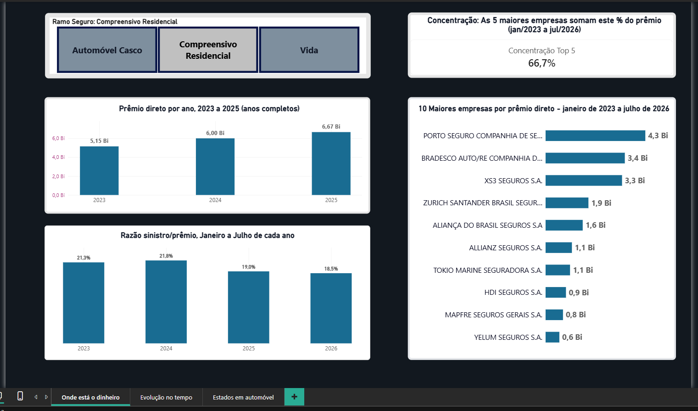
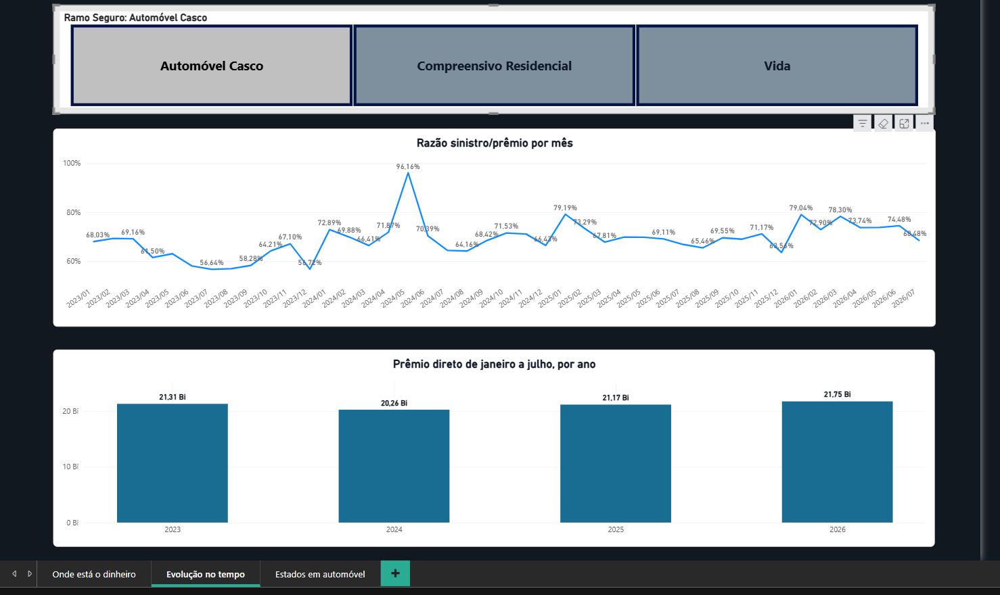
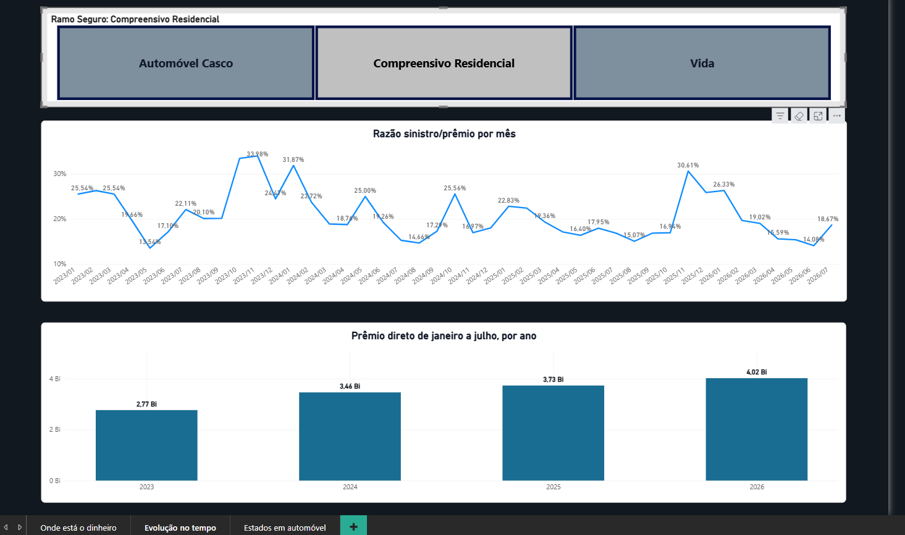
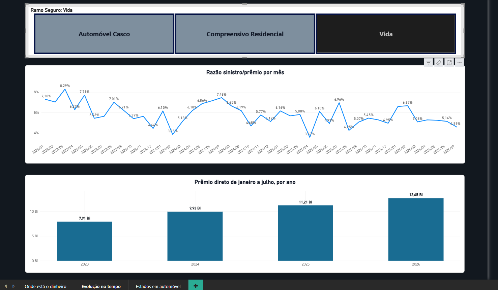
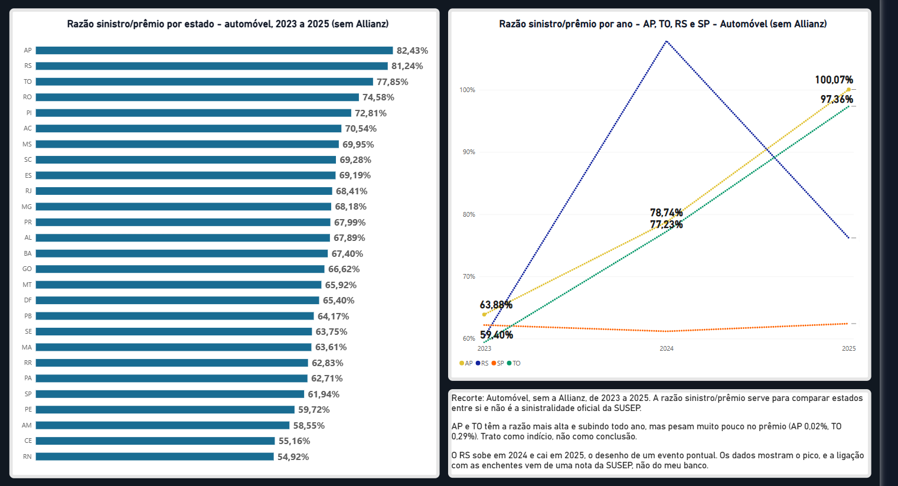

## O que encontrei (Automóvel)

- **Poucas empresas concentram o prêmio.** As 5 maiores seguradoras ficam com 72,3% do prêmio direto (jan/2023 a jul/2026). Porto Seguro lidera, com R$ 31,2 bi.
- **O prêmio ficou estável.** Por ano completo, ficou entre R$ 35,6 bi e R$ 37,5 bi (2023 a 2025). De janeiro a julho, entre R$ 20,3 bi e R$ 21,8 bi (2023 a 2026).
- **A razão sinistro/prêmio subiu.** De janeiro a julho, foi de 63,5% em 2023 para 74,3% em 2026. O gráfico mostra que subiu, não mostra o motivo.
- **Estados com razão alta pesam pouco.** Sem a Allianz, AP, RS e TO têm as razões mais altas (de 78% a 82%), mas AP e TO pesam só 0,02% e 0,29% do prêmio. Trato como indício, não como conclusão.
- **O RS foi um caso à parte.** A razão passou de 62,2% (2023) para 107,9% (2024) e voltou a 76,2% (2025). Parece evento pontual, e não tendência.
- **Cuidei dos dados.** Em 2023, os dados da Allianz têm valores por estado fora do padrão. Mantive o ano, marquei essas linhas e tirei a empresa das análises por estado.

A razão sinistro/prêmio aqui serve para comparar anos, estados e empresas entre si. Não é a sinistralidade oficial da SUSEP.
  
# Seguro SUSEP

Projeto de análise de dados reais de seguros no Brasil, feito em MariaDB/SQL, com a base pública do SES (Sistema de Estatísticas da SUSEP).

Montei o banco a partir dos arquivos da SUSEP, conferi se os dados fazem sentido e respondi perguntas que um gestor do setor poderia ter sobre três ramos: **Automóvel – Casco**, **Vida** e **Compreensivo Residencial**.

## O que descobri

- **Automóvel** é o maior ramo em prêmio. No mesmo período (janeiro a julho), a razão sinistro/prêmio foi de 63,5% em 2023 para 74,3% em 2026, com queda em 2025. Parte do salto de 2024 vem do Rio Grande do Sul (enchentes).
- **Residencial e Vida:** o prêmio cresce e a razão cai (Residencial de 21,3% para 18,5%; Vida de 6,8% para 5,5%, em janeiro a julho).
- **Poucas empresas concentram o mercado:** de 5 a 8 empresas somam 80% do prêmio em cada ramo.
- **Estados em Automóvel:** o Amapá piora a cada ano e passa de 100% em 2025, mas com prêmio pequeno, então trato como indício. O Rio Grande do Sul teve um pico em 2024 e caiu em 2025.
- **Dados por estado da Allianz em 2023 não são confiáveis.** Sinalizei essas linhas e deixei a empresa fora das análises por estado de Automóvel.

## Sobre os dados e o período

- Fonte: base do SES, tabela de prêmios e sinistros por empresa, ramo, mês e estado (UF), só com os três ramos acima.
<!-- CONFERIR: se a base tem outros ramos e você filtrou, diga "filtrei três ramos". -->
- Período: janeiro de 2023 a julho de 2026. **2026 tem só sete meses**, então quando comparo anos uso o mesmo período (janeiro a julho) ou deixo 2026 de fora.
- 109.142 registros, 27 UFs (26 estados e o Distrito Federal), 769 empresas no cadastro.
- Os valores estão em reais correntes, **sem correção pela inflação**.
- Conferência: o prêmio direto de Automóvel em 2024 no meu banco (R$ 35.633.163.776) é praticamente igual ao do portal da SUSEP (R$ 35.633.145.412), uma diferença de cerca de R$ 18 mil.

## Banco de dados

Banco `susep_seguros`, com três tabelas: `uf2` (prêmios e sinistros, uma linha por empresa, mês, ramo e UF), `ramos` e `empresas` (nome de cada empresa).

Os detalhes das tabelas estão em [ESTRUTURA_BANCO.md](ESTRUTURA_BANCO.md). As consultas estão em `analise_susep.sql`.

## Como ler os resultados

- **Prêmio direto:** o que as seguradoras arrecadam dos clientes.
- **Sinistro direto:** o valor da coluna `sin_dir`. A documentação da SUSEP diz só "Sinistros Diretos", então não sei se é sinistro pago, avisado ou ocorrido.
- **Razão sinistro/prêmio:** sinistro ÷ prêmio × 100. Se a razão é 70, para cada R$ 100 de prêmio apareceram R$ 70 de sinistro.

Essa razão é uma aproximação. **Não é a sinistralidade oficial da SUSEP**, que usa outros conceitos (para Automóvel em 2024, o portal mostra 61% e a minha razão dá 71%). Por isso uso a razão para comparar períodos dentro do mesmo ramo, e não para dizer qual é a sinistralidade do mercado.

---

## BLOCO A: onde está o dinheiro?

### Pergunta 1: quanto cada ramo arrecada e paga em sinistros, e a razão mudou de um ano para o outro?

**1A. Anos completos (2023 a 2025), valores em R$ bilhões.** Serve para ver o tamanho de cada ramo. Deixei 2026 de fora porque só tem janeiro a julho.

| Ramo | Ano | Prêmio direto | Sinistro direto | Razão |
|---|---|---|---|---|
| Auto | 2023 | 36,72 | 22,86 | 62,24% |
| Auto | 2024 | 35,63 | 25,30 | 70,99% |
| Auto | 2025 | 37,49 | 26,01 | 69,38% |
| Resid | 2023 | 5,15 | 1,22 | 23,73% |
| Resid | 2024 | 6,00 | 1,23 | 20,45% |
| Resid | 2025 | 6,67 | 1,32 | 19,85% |
| Vida | 2023 | 14,71 | 0,93 | 6,29% |
| Vida | 2024 | 17,86 | 1,06 | 5,93% |
| Vida | 2025 | 20,37 | 1,09 | 5,33% |

**1B. Razão no mesmo período (janeiro a julho de todos os anos).** Serve para comparar a razão entre anos, incluindo 2026.

| Ramo | 2023 | 2024 | 2025 | 2026 |
|---|---|---|---|---|
| Auto | 63,53% | 73,09% | 70,75% | 74,31% |
| Resid | 21,32% | 21,83% | 18,96% | 18,48% |
| Vida | 6,79% | 6,14% | 5,60% | 5,47% |

**O que mostra:**
- **Automóvel** é o maior ramo em prêmio. A razão subiu de 2023 para 2024, caiu um pouco em 2025 e subiu de novo em 2026. Parte da subida de 2024 pode vir do Rio Grande do Sul (veja a pergunta 7).
- **Residencial:** a razão ficou perto de 21% até 2024 e caiu a partir de 2025.
- **Vida:** a razão cai todo ano, mas quase parou entre 2025 e 2026.

**Cuidado:** a razão de Vida é muito baixa e não sei dizer o que o sinistro direto captura nesse ramo. Por isso comparo cada ramo com ele mesmo ao longo do tempo, e não os ramos entre si.

### Pergunta 2: como a razão evoluiu mês a mês, e em quais meses foi mais crítica?

Os 3 meses com a razão mais alta de cada ramo:

| Ramo | 1º | 2º | 3º |
|---|---|---|---|
| Auto | 05/2024 (96,16%) | 01/2025 (79,19%) | 01/2026 (79,04%) |
| Resid | 11/2023 (33,98%) | 10/2023 (33,46%) | 01/2024 (31,87%) |
| Vida | 03/2023 (8,29%) | 05/2023 (7,71%) | 07/2024 (7,46%) |

**O que mostra:** o pior mês de Automóvel, maio de 2024, destoa dos vizinhos (entre 66% e 72%). Esse mês coincide com as enchentes no Rio Grande do Sul (veja a pergunta 7). Os outros meses mais altos de Automóvel são janeiros.

**Cuidado:** a razão de um mês isolado oscila mais que a anual, e poucos anos de dados não bastam para falar em "época do ano" com segurança.

### Pergunta 3: quais são as maiores empresas de cada ramo?

As três maiores por prêmio direto no período (janeiro de 2023 a julho de 2026). A consulta calcula o ranking pelo código da empresa e depois busca o nome na tabela `empresas` (`LEFT JOIN`).

| Ramo | Empresa | Prêmio (R$ bi) | % do ramo |
|---|---|---|---|
| Auto | Porto Seguro Companhia de Seguros Gerais | 31,22 | 23,7% |
| Auto | Tokio Marine Seguradora | 20,58 | 15,6% |
| Auto | Bradesco Auto/RE Companhia de Seguros | 17,74 | 13,5% |
| Resid | Porto Seguro Companhia de Seguros Gerais | 4,33 | 19,8% |
| Resid | Bradesco Auto/RE Companhia de Seguros | 3,44 | 15,7% |
| Resid | XS3 Seguros | 3,32 | 15,2% |
| Vida | Bradesco Vida e Previdência | 28,53 | 43,5% |
| Vida | Prudential do Brasil Seguros | 9,76 | 14,9% |
| Vida | Prudential do Brasil Seguros de Vida | 7,89 | 12,0% |

**O que mostra:**
- A Porto Seguro lidera Automóvel e Residencial e aparece em 7º lugar em Vida (R$ 1,71 bi, 2,6% do ramo).
- Em Vida, a líder tem quase metade do ramo. Em 2º e 3º aparecem duas empresas com nome de Prudential. Pelo nome parecem ser do mesmo grupo (não verifiquei), e somadas teriam 26,9% do ramo.
- A Allianz é a 4ª maior de Automóvel, com R$ 14,54 bi (11,0% do ramo). Ela fica fora das análises por estado (perguntas 6 e 7).

A consulta completa traz as 10 maiores de cada ramo.

### Pergunta 4: quantas empresas somam 80% do prêmio de cada ramo?

| Ramo | Empresas no ramo | Empresas que somam 80% |
|---|---|---|
| Vida | 65 | 5 |
| Automóvel | 56 | 7 |
| Residencial | 61 | 8 |

<!-- CONFERIR: a coluna "Empresas no ramo" não sai da consulta do arquivo. Escreva a consulta e confirme os números. -->

**O que mostra:** nos três ramos, menos de 15% das empresas concentram 80% do prêmio. Vida é o mais concentrado.

**Cuidado:** "empresa" aqui é cada entidade que envia dados à SUSEP. Não juntei empresas do mesmo grupo econômico. Um exemplo está na pergunta 3: em Vida, as duas Prudential aparecem separadas. Juntar os grupos deixaria o mercado ainda mais concentrado.

---

## BLOCO B: para onde o mercado cresce?

### Pergunta 5: o prêmio de cada ramo está crescendo de um ano para o outro?

Comparação de **janeiro a julho** em todos os anos, porque 2026 só tem esses meses.

| Ramo | 2023 | 2024 | 2025 | 2026 |
|---|---|---|---|---|
| Auto (R$ bi) | 21,31 | 20,26 | 21,17 | 21,75 |
| variação | – | −4,92% | +4,50% | +2,73% |
| Resid (R$ bi) | 2,77 | 3,46 | 3,73 | 4,02 |
| variação | – | +25,10% | +7,78% | +7,76% |
| Vida (R$ bi) | 7,91 | 9,93 | 11,21 | 12,65 |
| variação | – | +25,56% | +12,88% | +12,84% |

**O que mostra:**
- Automóvel ficou praticamente estável: cerca de +2% de 2023 a 2026, com queda em 2024.
- Residencial cresceu cerca de 45% no período e Vida cerca de 60%. Nos dois, o ritmo diminuiu depois de 2024.

**Cuidado:** os valores são nominais. Com a inflação descontada, o crescimento real é menor, e Automóvel provavelmente não cresceu em termos reais. Não consigo explicar com os dados a queda de Automóvel em 2024.

---

## BLOCO C: onde está o risco?

### Pergunta 6: em Automóvel, quais estados têm a razão mais alta, e eles pesam em volume?

**Sem a Allianz e sem 2026** (janeiro de 2023 a dezembro de 2025). Os 5 estados com a razão mais alta e dois de referência:

| Estado | Razão | Peso no prêmio de Auto |
|---|---|---|
| AP | 82,43% | 0,02% |
| RS | 81,24% | 6,51% |
| TO | 77,85% | 0,29% |
| RO | 74,58% | 0,26% |
| PI | 72,81% | 0,24% |
| SP (maior estado) | 61,94% | 43,99% |
| RN (menor razão) | 54,92% | 0,68% |

**O que mostra:**
- Os estados do topo, menos o RS, pesam menos de 0,3% do prêmio cada. Com pouco volume, um único sinistro grande muda bastante a razão.
- O RS é a exceção: a razão dele é quase igual à do AP (81,24% contra 82,43%) e ele pesa 6,5% do prêmio. Sem exigir um volume mínimo, o AP aparece como o pior estado, e o RS vem logo atrás.
- SP, MG, PR, RJ e RS somam cerca de 73% do prêmio.
- A razão fica entre 55% e 82% nos 27 estados.

**Cuidado:** a razão do RS inclui maio e junho de 2024 (veja a pergunta 7). Também não sei como a SUSEP atribui cada valor a um estado, então não dá para dizer que os motoristas de um estado "custam mais".

### Pergunta 7: o pior resultado de um estado em Automóvel é tendência ou evento pontual?

Razão sinistro/prêmio de Automóvel período de 2023 a 2025, **sem a Allianz e sem 2026** (2026 até a criação dessa análise o BD susep de 2026 só tem sete meses):

| Estado | 2023 | 2024 | 2025 | Prêmio por ano |
|---|---|---|---|---|
| AP (pior razão em 2025) | 63,88% | 78,74% | 100,07% | R$ 6,6 a 8,4 milhões |
| TO | 59,40% | 77,23% | 97,36% | R$ 92 a 94 milhões |
| RS | 60,29% | 107,89% | 76,20% | cerca de R$ 2,1 bilhões |
| SP | 62,20% | 61,19% | 62,42% | cerca de R$ 14 a 14,5 bilhões |

Escolhi esses estados depois de olhar os dados: o Estado do AMAPÁ (AP) apresentou a maior razão em 2025, o RIO GRANDE DO SUL (RS) foi incluído pelo contexto dos eventos climáticos (enchentes), SÃO PAULO (SP) é o maior mercado de seguro do país e o TOCANTINS (TO) apresenta uma evolução semelhante à do AP - pertecendo a mesma região, com maior volume de prêmios. A seleção foi proposital, não automática.

**O que mostra:**
- **RS:**a razão (sinistro direto/premio direto) sobe de 60,29% para 107,89% em 2024 e cai para 76,20% em 2025. O comportamento sugere um evento pontual, devido a causa fortuita e/ou força maior, incidente de eventos climáticos.(https://www.gov.br/susep/pt-br/central-de-conteudos/noticias/2024/julho/reflexo-da-tragedia-no-sul-sinistralidade-nos-seguros-de-danos-salta-em-maio-para-66-1)
- **AP e TO:** Estes dois estados acenderam um sinal de alerta ao apresentarem uma alta contínua que descolou do restante do país. Entre 2023 e 2024, o aumento da sinistralidade foi um movimento comum no Brasil. No entanto, em 2025, enquanto mais da metade dos estados brasileiros conseguiu controlar e estabilizar seus índices entre 72% e 79%, o Tocantins saltou para 97,36% e o Amapá atingiu 100,07%, evidenciando uma perda real de margem financeira nessas duas praças.
- **SP:** relativamente estável nos três anos na casa de 61% a 62%. Como São Paulo possui uma base imensa de clientes (arrecadando mais de 14 bilhões por ano), o Estado se benefícia da lei das grandes proporções - as variações diárias e os custos locais de oficinas são absorvidos e diluídos naturalmente pelo tamanho do próprio marcado.

**Cuidado:** são três anos de dados. O prêmio do AP é pequeno, então poucos sinistros grandes mudam o número, e trato o AP como indício. Refiz a análise sem a Allianz em todos os anos, porque a marcação de anomalia só tirava essa empresa em parte de 2023, e o desenho se manteve.

---

## BLOCO D: dá para confiar nos números?

### Pergunta 8: em 2023, o resultado extremo de Sergipe em Automóvel está concentrado em poucos meses?

Todas as empresas somadas:

| Mês de 2023 | Prêmio (R$ mi) | Sinistro (R$ mi) | Razão |
|---|---|---|---|
| Março | 18,2 | **−4.153,7** | −22.875% |
| Os outros 11 meses | 15 a 18 | 5 a 12 | 29% a 68% |

**O que mostra:** o valor extremo está num mês só, março. Os outros meses têm valores normais. Um sinistro negativo de R$ 4,15 bilhões para um prêmio mensal de R$ 18 milhões não é plausível para um estado.

### Pergunta 9: os números por estado são confiáveis?

> *Nota: esta pergunta foi construída com apoio de IA. A estratégia de comparar o total nacional da empresa com o pior estado foi sugerida, e eu executei as consultas. Ainda estou estudando os detalhes das funções usadas.*

**O que encontrei:**
- Procurei linhas em que o sinistro, em valor absoluto, passa de R$ 50 milhões e de 20 vezes o prêmio daquele estado. Em toda a base, só uma combinação apareceu: **Allianz (05177), Automóvel, 2023**, com 20 linhas.
- Exemplo (março de 2023, só a Allianz): Mato Grosso com sinistro de +R$ 5,32 bi para prêmio de R$ 12 mi, e Sergipe com −R$ 4,16 bi para prêmio de R$ 2,6 mi. Os valores estão assim na fonte da SUSEP, conferi no arquivo original.
- O **total nacional** da empresa parece coerente: razão entre 68% e 109% nos 12 meses de 2023. O problema parece estar na distribuição por estado.
- De janeiro a agosto de 2023 a empresa tem sinistros negativos em vários estados. De setembro a dezembro de 2023, e em 2024 a 2026, não.

**O que fiz:** mantive as linhas e marquei com `flag_anomalia_uf = 1` o bloco inteiro da Allianz em Automóvel, de janeiro a agosto de 2023 (216 linhas), e não só as 20 mais extremas. Nas análises nacionais uso tudo, porque o total parece certo. Nas análises por estado de Automóvel, deixo a Allianz de fora.
<!-- CONFERIR: 216 = 27 UFs x 8 meses. Rode SELECT COUNT(*) FROM uf2 WHERE flag_anomalia_uf = 1; (deve dar 216) e confirme em qual script está o UPDATE que marca essas linhas. -->

**O que não sei:** a causa. Pode ser erro de envio, reclassificação ou uma regra de alocação por estado que eu desconheço.

**Limite:** o teste só pega distorções grandes. Erros menores podem ter passado.

---

## Limitações

- A razão sinistro/prêmio não é a sinistralidade oficial (explicado acima).
- A tabela não tem sinistro retido. A coluna `prem_ret_liq` é cópia de prêmio retido, então descartei. `salvados` e `recuperacao` são zero em todo o período e também foram descartadas.
<!-- CONFERIR: a tabela uf2 tem as colunas premio_ret e grupamento, que nenhuma análise usa. Se quiser, diga em uma linha o que são e por que ficaram de fora. -->
- Não sei se `sin_dir` é sinistro pago, avisado ou ocorrido.
- A base é agregada por empresa, ramo e estado. Não tem clientes nem apólices individuais.
- O prêmio de Automóvel em 2024 no meu banco difere do portal em cerca de R$ 18 mil. Não investiguei a causa.
- Nas análises por estado de Automóvel, a Allianz fica de fora. Ela é a 4ª maior do ramo (11,0% do prêmio), então essas análises não cobrem essa parte do mercado, e os valores em reais por estado ficam menores que os reais.
- Não juntei empresas do mesmo grupo econômico (veja a pergunta 3).

## SQL utilizado

- `CASE WHEN`, `GROUP BY`, `SUM`, `ROUND`, `LEFT` e `RIGHT` (todas as perguntas)
- CTEs com `WITH` (perguntas 2 a 7)
- Funções de janela: `ROW_NUMBER` (2, 3, 4), `SUM() OVER` (3, 4), `LAG` (5)
- `LEFT JOIN` (3)
- `CROSS JOIN` (6 e 7)
- `NULLIF`, `ABS` e `MAX` (9)

## Sobre o uso de IA

Usei IA (ChatGPT e Claude) para pensar o que perguntar sobre os dados e
para revisar o meu trabalho.

- Escrevi as consultas das perguntas 1A, 1B, 2, 3, 4, 5, 6, 7 e 8.
- A investigação da qualidade dos dados (colunas e anomalia da Allianz)
  teve orientação de IA. Conferi os números contra o portal da SUSEP.
- Os números e as conclusões saem das minhas consultas. O texto do README
  foi escrito com IA a partir dos meus resultados, revisão e orientação de escrita.
- Optei pela estruturação do README pela IA a fim de polir a linguagem e tornar 
  o texto mais fluído.
  
## Como recriar o banco

O banco está só no meu computador, então ainda não dá para recriá-lo
a partir deste repositório.

- Fonte dos dados: base pública do SES (SUSEP). Link == https://www2.susep.gov.br/redarq.asp?arq=BaseCompleta%2ezip
- As consultas estão em `analise_susep.sql`.
- A estrutura das tabelas está em ESTRUTURA_BANCO.md.
- Não publiquei os arquivos de dados nem os scripts de carga.

## Power BI

Relatório com 3 páginas, feito a partir do `uf2_limpo.csv` e do `empresas.csv`. Em cada página, os botões trocam o ramo: Automóvel, Residencial e Vida. As perguntas 8 e 9 ficaram só no SQL.

### Página 1: Onde está o dinheiro
Prêmio direto por ano (2023 a 2025), razão sinistro/prêmio de janeiro a julho de cada ano, as 10 maiores empresas por prêmio e quanto as 5 maiores concentram do ramo. Recorte: janeiro de 2023 a julho de 2026, com a Allianz.

Ver Residencial e Vida

### Página 2: Evolução no tempo
Razão sinistro/prêmio mês a mês e prêmio direto de janeiro a julho de cada ano, de 2023 a 2026.

Ver Residencial e Vida

### Página 3: Estados em automóvel
Razão sinistro/prêmio por estado no Automóvel, de 2023 a 2025, sem a Allianz. AP, RS e TO têm as razões mais altas, mas AP e TO pesam muito pouco no prêmio (0,02% e 0,29%). Trato como indício, não como conclusão.

### Medidas em DAX

| Medida | O que responde |
|---|---|
| Prêmio Direto | Quanto as seguradoras arrecadaram no recorte |
| Sinistro Direto | Quanto pagaram em sinistros no recorte |
| Razão S/P | De cada real recebido, quanto volta em sinistro |
| Peso UF | Quanto cada estado pesa no prêmio |
| Participação % | Quanto cada empresa pesa no prêmio |
| Prêmio Top 5 | Quanto as 5 maiores empresas arrecadaram |
| Concentração Top 5 | Que parte do prêmio fica com as 5 maiores |
| Prêmio Ano Anterior | Prêmio no mesmo período do ano anterior |
| Variação % | Quanto o prêmio cresceu ou caiu sobre o ano anterior |

Fórmulas, explicação de cada uma e a consulta equivalente em SQL: [power_bi/medidas_dax.md](power_bi/medidas_dax.md)

Todas as fórmulas foram escritas por mim. Em alguns momentos pedi ajuda de IA para entender o que cada comando faz e quando usá-lo.
